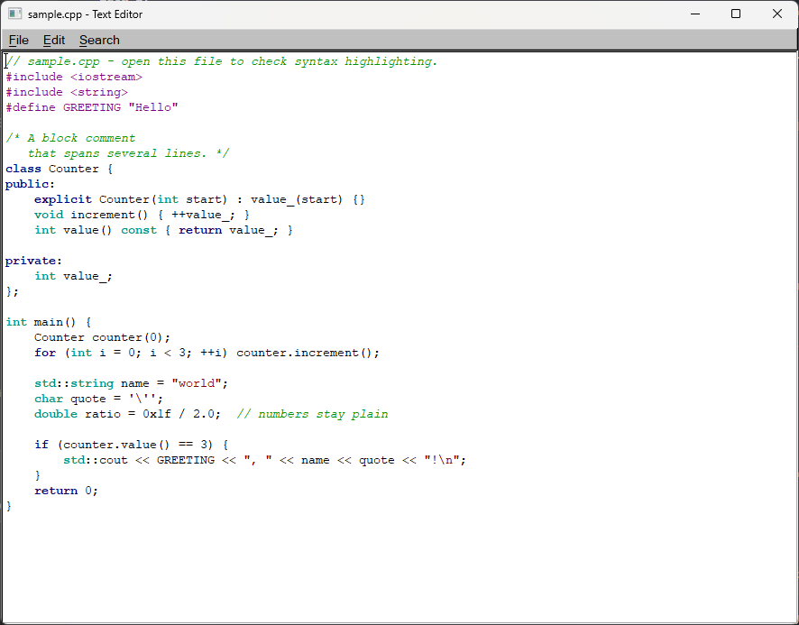
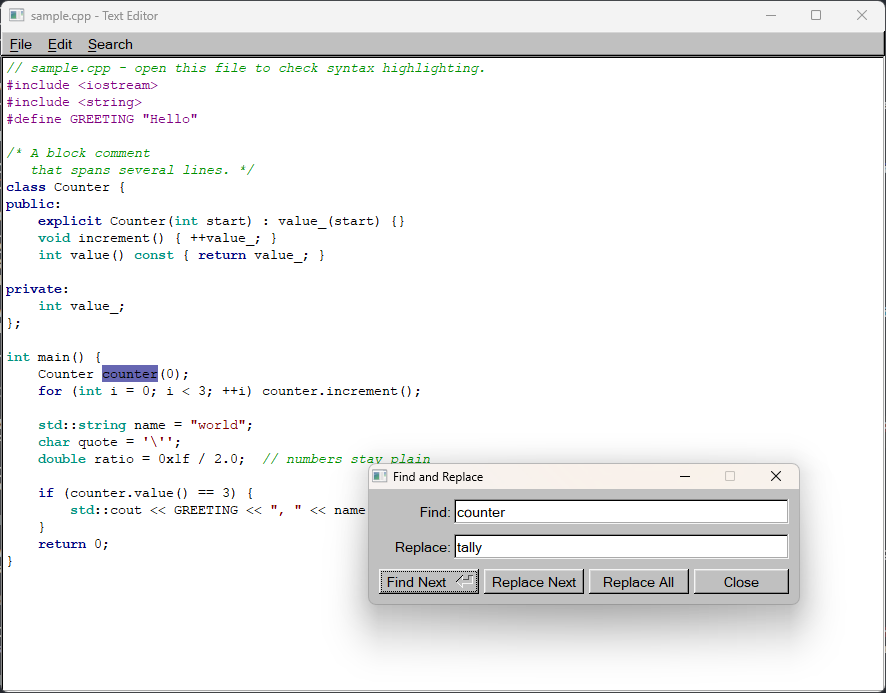
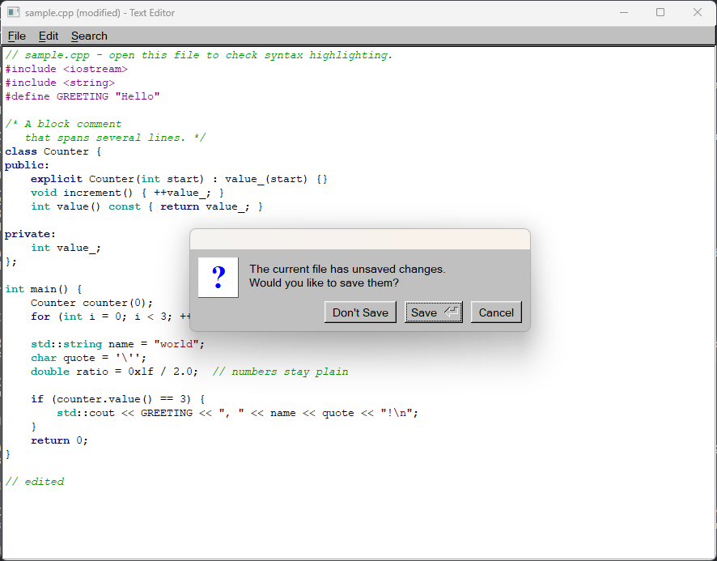
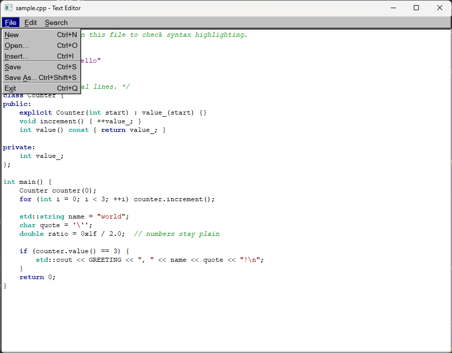
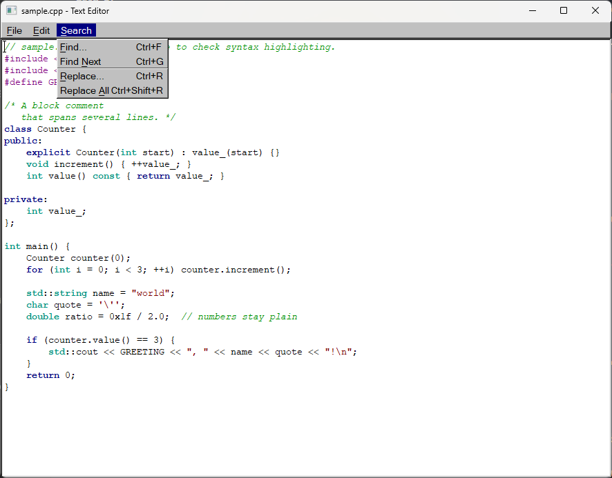
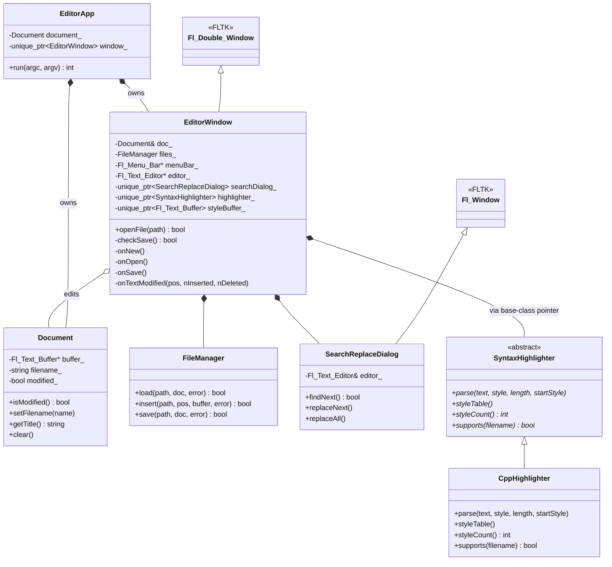
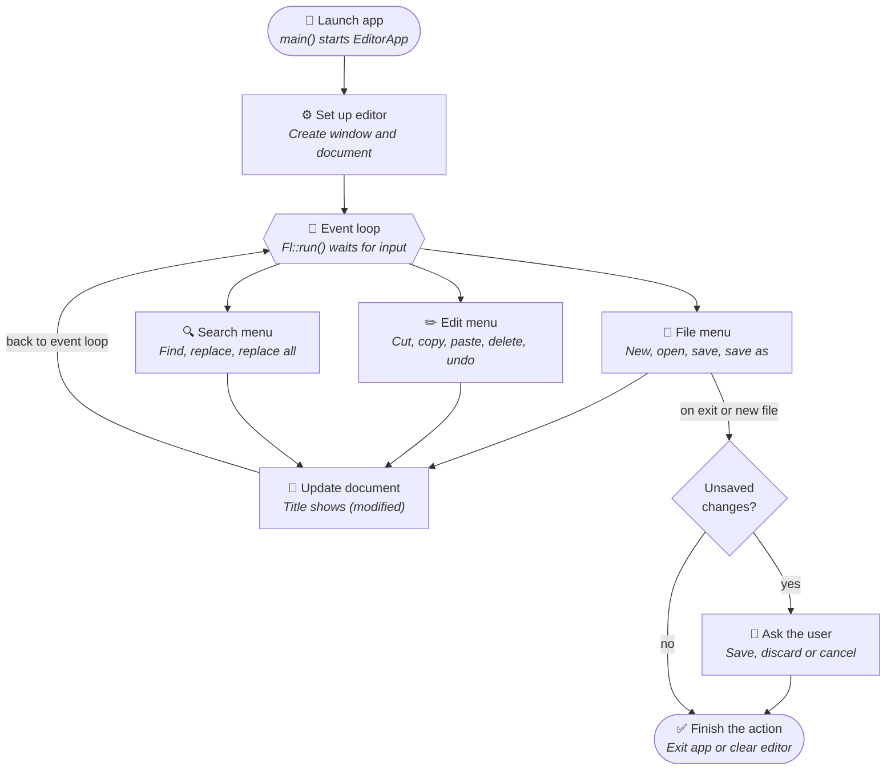
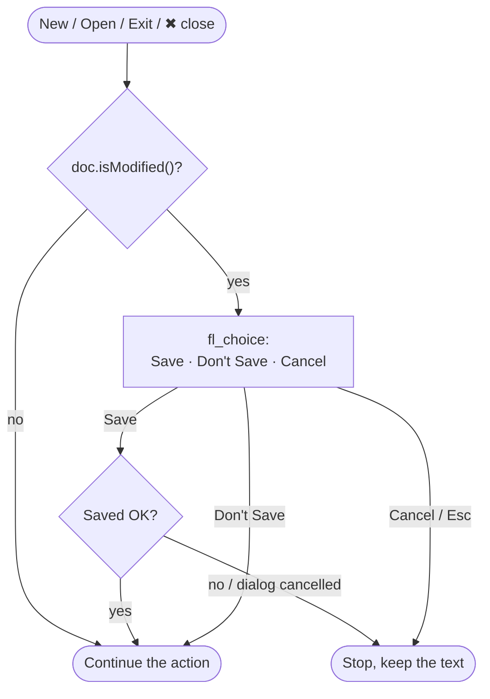
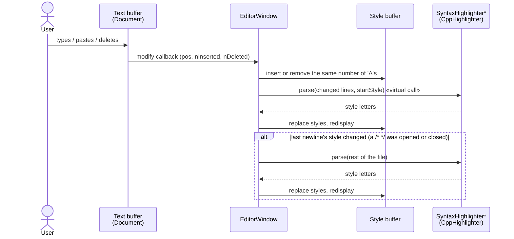
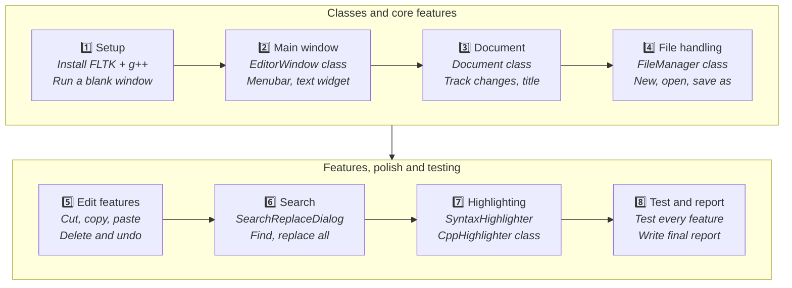

<div align="center">

# 📝 Simple Text Editor — C++ · FLTK · OOP

**A lightweight desktop text editor with C/C++ syntax highlighting, built from seven small classes that each do one job.**




*OOPs course project · International Institute of Information Technology, Bhubaneswar*

</div>

---

## 📚 Contents

- [About the project](#-about-the-project)
- [Features](#-features)
- [Screenshots](#-screenshots)
- [Keyboard shortcuts](#%EF%B8%8F-keyboard-shortcuts)
- [Architecture](#%EF%B8%8F-architecture)
- [System workflow](#-system-workflow)
- [How syntax highlighting works](#-how-syntax-highlighting-works)
- [Development workflow](#%EF%B8%8F-development-workflow)
- [Getting started](#-getting-started)
- [Project structure](#-project-structure)
- [Testing](#-testing)
- [Scope and future enhancements](#-scope-and-future-enhancements)
- [Author](#-author)

---

## 💡 About the project

A text editor is one of the most frequently used programs on a computer. Widely used editors contain so much code that their internal design is hard to study. This project builds a **small editor that still covers the essential features**, so its complete design can be understood and explained.

An editor like this *could* be written with global variables for the text buffer, the file name and the modified flag, plus separate C-style callback functions. That works, but every function then depends on shared global state, which makes the code hard to extend, test and reuse.

So the project has two aims:

1. 🛠️ **Build a working, menu-driven text editor.**
2. 🧱 **Design it with object-oriented principles.** Data is encapsulated in classes, each class has a single responsibility, and new features can be added without rewriting existing code.

> 📄 The original project abstract is in [`Text Editor in C++ using FLTK and OOP — Project Abstract.pdf`](Text%20Editor%20in%20C++%20using%20FLTK%20and%20OOP%20%E2%80%94%20Project%20Abstract.pdf), and the full project report is in [`docs/REPORT.md`](docs/REPORT.md).

---

## ✨ Features

| | Feature | Details |
|:-:|---|---|
| 📂 | **File handling** | New, Open, Insert a file at the cursor, Save, Save As, with native file dialogs |
| ✂️ | **Editing** | Cut, Copy, Paste, Delete, Undo |
| 🔍 | **Find & Replace** | Find Next, Replace Next and Replace All in a non-modal dialog; searches wrap around |
| 💾 | **Unsaved-change protection** | Title shows **`(modified)`**; New, Open, Exit and the close button ask *Save / Don't Save / Cancel* |
| 🎨 | **C/C++ syntax highlighting** | Keywords, data types, strings, comments and preprocessor directives, each in its own colour and font style |
| ⚠️ | **Clear error messages** | Unreadable or unwritable files show the system's reason, e.g. *"No such file or directory"* |
| ⌨️ | **Shortcuts for everything** | Every menu item has a keyboard shortcut |
| 🖥️ | **Command-line open** | `TextEditor.exe samples/sample.cpp` |

---

## 📸 Screenshots

<table>
  <tr>
    <td align="center" width="50%">
      <br>
      <b>Find &amp; Replace</b>: the match is selected in the editor
    </td>
    <td align="center" width="50%">
      <br>
      <b>Unsaved-change protection</b>: Save, Don't Save or Cancel
    </td>
  </tr>
  <tr>
    <td align="center">
      <br>
      <b>File menu</b> with shortcuts
    </td>
    <td align="center">
      <br>
      <b>Search menu</b> with shortcuts
    </td>
  </tr>
</table>

---

## ⌨️ Keyboard shortcuts

<table>
<tr><th>📁 File</th><th>✏️ Edit</th><th>🔍 Search</th></tr>
<tr valign="top"><td>

| Action | Keys |
|---|---|
| New | `Ctrl+N` |
| Open… | `Ctrl+O` |
| Insert… | `Ctrl+I` |
| Save | `Ctrl+S` |
| Save As… | `Ctrl+Shift+S` |
| Exit | `Ctrl+Q` |

</td><td>

| Action | Keys |
|---|---|
| Undo | `Ctrl+Z` |
| Cut | `Ctrl+X` |
| Copy | `Ctrl+C` |
| Paste | `Ctrl+V` |
| Delete | `Del` |

</td><td>

| Action | Keys |
|---|---|
| Find… | `Ctrl+F` |
| Find Next | `Ctrl+G` |
| Replace… | `Ctrl+R` |
| Replace All | `Ctrl+Shift+R` |

</td></tr>
</table>

---

## 🏛️ Architecture

Instead of global variables and free functions, the editor is built from **seven classes, each with one clear responsibility**.

### Class diagram



### Responsibilities

| Class | Inherits from | Responsibility |
|---|---|---|
| `EditorApp` | — | Starts the program, owns the document and the window, runs the event loop |
| `EditorWindow` | `Fl_Double_Window` | Holds the menu bar and the `Fl_Text_Editor` widget, handles menu actions |
| `Document` | — | Stores the text buffer, file name and modified flag; builds the window title |
| `FileManager` | — | Loads and saves files, reports read and write errors |
| `SearchReplaceDialog` | `Fl_Window` | Find and replace inputs and buttons: find next, replace next, replace all |
| `SyntaxHighlighter` *(abstract)* | — | Interface with a pure virtual `parse()` method for styling text |
| `CppHighlighter` | `SyntaxHighlighter` | Styles C/C++ keywords, types, strings, comments and directives |

### 🧱 The four pillars of OOP

| Pillar | Where it appears |
|---|---|
| 🔒 **Encapsulation** | `Document` keeps the buffer, file name and modified flag **private** and exposes only methods such as `isModified()`, `setFilename()` and `getTitle()`. The modified flag is set from inside `Document`, so no other class can forget to set it. |
| 🧬 **Inheritance** | `EditorWindow` extends `Fl_Double_Window`, `SearchReplaceDialog` extends `Fl_Window`, and `CppHighlighter` extends `SyntaxHighlighter`. |
| 🎭 **Abstraction** | `SyntaxHighlighter` defines *what* a highlighter does without saying *how*, so the editor depends only on the interface. |
| 🔀 **Polymorphism** | The window calls `highlighter_->parse()` through a **base-class pointer**, so a new language highlighter can be added without changing the window. |

### 🧩 Design challenge: FLTK callbacks

FLTK callbacks must be static or free functions. Each class uses a **static member function that casts the `void*` user data back to the object** and calls a normal member function, which keeps all the logic inside the class:

```cpp
// EditorWindow.h
static void cb_save(Fl_Widget*, void* v) { static_cast<EditorWindow*>(v)->onSave(); }

// EditorWindow.cpp
menuBar_->add("&File/&Save", FL_COMMAND + 's', cb_save, this);
```

The same pattern is used for the text buffer's modify callbacks in `Document` and `EditorWindow`, and for the buttons in `SearchReplaceDialog`.

---

## 🔄 System workflow

Every user action runs through the event loop and updates the document.



On launch, `main()` creates the document and the editor window, then hands control to FLTK's event loop. Each menu choice or shortcut runs a callback that changes the document, and the title bar shows **"(modified)"** until the file is saved. Before exiting or starting a new file, the editor checks for unsaved changes and asks the user to **save, discard or cancel**.

### Unsaved-changes decision in detail



---

## 🎨 How syntax highlighting works

`Fl_Text_Display` can draw text using a second **style buffer** that holds one style letter per character of the text:

| Style | Meaning | Look |
|:-:|---|---|
| `A` | Plain text | black |
| `B` | `// line comment` | green italic |
| `C` | `/* block comment */` | green italic |
| `D` | `"strings"` and `'c'` | dark red |
| `E` | `#preprocessor` directives | magenta |
| `F` | Data types (`int`, `double`, `string`, …) | cyan bold |
| `G` | Keywords (`class`, `return`, `for`, …) | blue bold |

Only the changed lines are re-parsed, not the whole file:



Highlighting is switched on by `CppHighlighter::supports()` for `.c .cpp .cc .cxx .h .hpp .hh .hxx` files and for new documents. Plain `.txt` files stay unstyled.

---

## 🗺️ Development workflow

The project was built in **eight phases, each ending in a working build** and its own Git commit.



Run `git log --oneline` to see one commit per phase.

---

## 🚀 Getting started

### Prerequisites

- A C++17 compiler (GCC, Clang or MSVC)
- **FLTK 1.3 or 1.4**
- `make` or CMake

### 🪟 Windows (MSYS2)

```sh
# 1. Install MSYS2 (or download it from https://www.msys2.org)
winget install MSYS2.MSYS2

# 2. In the "MSYS2 UCRT64" shell, install the compiler and FLTK
pacman -S mingw-w64-ucrt-x86_64-gcc mingw-w64-ucrt-x86_64-fltk make

# 3. Build and run from the project folder
make
./TextEditor.exe samples/sample.cpp
```

> 💡 The Makefile links FLTK **statically**, so `TextEditor.exe` also runs on its own, outside MSYS2.

### 🐧 Linux

```sh
sudo apt install g++ make libfltk1.3-dev   # Debian / Ubuntu
make
./TextEditor samples/sample.cpp
```

### 🧰 CMake (any platform)

```sh
cmake -S . -B build/cmake
cmake --build build/cmake
```

> On MSYS2 the CMake build uses the FLTK DLL, so run it from the UCRT64 shell (or copy the DLL next to the exe).

---

## 📁 Project structure

```
📦 Simple-Text-Editor-using-CPP
 ┣ 📂 include                      headers, one per class
 ┃ ┣ 📜 EditorApp.h
 ┃ ┣ 📜 EditorWindow.h
 ┃ ┣ 📜 Document.h
 ┃ ┣ 📜 FileManager.h
 ┃ ┣ 📜 SearchReplaceDialog.h
 ┃ ┣ 📜 SyntaxHighlighter.h        abstract interface
 ┃ ┗ 📜 CppHighlighter.h
 ┣ 📂 src                          one source file per class
 ┃ ┣ 📜 main.cpp                   EditorApp app; return app.run(argc, argv);
 ┃ ┣ 📜 EditorApp.cpp
 ┃ ┣ 📜 EditorWindow.cpp
 ┃ ┣ 📜 Document.cpp
 ┃ ┣ 📜 FileManager.cpp
 ┃ ┣ 📜 SearchReplaceDialog.cpp
 ┃ ┗ 📜 CppHighlighter.cpp
 ┣ 📂 samples
 ┃ ┗ 📜 sample.cpp                 try highlighting and search on this
 ┣ 📂 docs
 ┃ ┣ 📂 images                     screenshots used in this README
 ┃ ┗ 📜 REPORT.md                  full project report
 ┣ 📜 Makefile                     builds with fltk-config
 ┣ 📜 CMakeLists.txt
 ┗ 📜 Text Editor in C++ using FLTK and OOP — Project Abstract.pdf
```

---

## 🧪 Testing

Every menu item and the edge cases named in the abstract were tested by running the editor. The results:

| Area | What was checked | |
|---|---|:-:|
| Title | "Untitled", file name, and "(modified)" after typing; cleared after save or New | ✅ |
| Files | Open from command line, Save (shortcut and menu), missing file shows an error | ✅ |
| Unsaved changes | Exit and close button → Save, Don't Save, Cancel each behave correctly | ✅ |
| Edit | Cut, paste, delete, undo give the expected text | ✅ |
| Search | Replace All count, Replace Next wraps around, empty search gives a warning | ✅ |
| Highlighting | All styles on `sample.cpp`; adding or removing `/*` restyles later lines; `.txt` stays plain | ✅ |
| Build | `make` with `-Wall -Wextra` gives no warnings; CMake build compiles | ✅ |

The full test table is in [`docs/REPORT.md`](docs/REPORT.md#6-testing).

---

## 🔭 Scope and future enhancements

**In scope:** a single-window desktop editor for plain text files, one document at a time, with the editing and search features above, unsaved-change protection, and C/C++ syntax highlighting.

**Out of scope for now:** multiple tabs, rich text formatting, printing, spell checking, plugins, and cloud storage.

**Planned enhancements:**

- [ ] 🗂️ Multiple documents in tabs
- [ ] 🔢 Line numbers and a status bar showing the cursor position
- [ ] 🐍 Highlighters for more languages (Python, Java) as new `SyntaxHighlighter` subclasses
- [ ] 🔠 Case-insensitive and whole-word search options
- [ ] 🕘 Recent files list and auto-save

---

## 👤 Author

<table>
  <tr><td><b>Name</b></td><td>Roushan Sharma</td></tr>
  <tr><td><b>Branch</b></td><td>CSE-B</td></tr>
  <tr><td><b>Roll No.</b></td><td>B125103</td></tr>
  <tr><td><b>Subject</b></td><td>Object-Oriented Programming (OOPs)</td></tr>
  <tr><td><b>Institute</b></td><td>International Institute of Information Technology, Bhubaneswar</td></tr>
</table>

<div align="center">

Built with ❤️ in C++ and [FLTK](https://www.fltk.org/)

</div>
